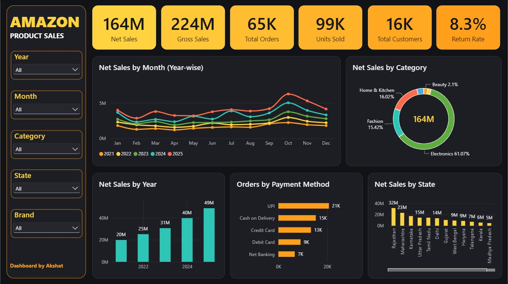

# 🛒 Amazon E-Commerce Sales & Revenue Dashboard (Power BI)

An interactive, end-to-end Power BI analytics dashboard designed to monitor multi-channel sales performance, evaluate regional fulfillment efficiency, analyze category-level profitability, and uncover seasonal revenue drivers.

---

## 📌 Project Overview & Objectives
E-commerce retail operations generate large volumes of transactional data across various geographical hubs, delivery channels, and inventory categories. The objective of this project is to transform raw marketplace data into actionable business intelligence for executive decision-making.

### Key Objectives:
* **Executive Performance Tracking**: Provide top-line visibility into gross revenue, order volume, return rates, and average order value (AOV).
* **Fulfillment Optimization**: Compare dispatch performance between Amazon FBA and merchant-fulfilled delivery channels.
* **Geographical Segmentation**: Identify high-demand clusters across Indian tier-1 and tier-2 states to streamline regional supply chains.
* **Category Contribution**: Track sales mix distribution across Apparel, Electronics, and Home categories.

---

## 📊 Dashboard Preview


---

## 📁 Repository Contents
* **[`Amazon_Sales_Dashboard.pbix`](./Amazon_Sales_Dashboard.pbix)**: Complete Power BI Desktop report containing the interactive report canvas, data model, and DAX measures.
* **[`Amazon Sales Dashboard Project Report.pdf`](./Amazon%20Sales%20Dashboard%20Project%20Report.pdf)**: Comprehensive academic and technical project report.
* **`dashboard_screenshot.png`**: High-resolution screenshot of the dashboard interface.

---

## 🔍 Dataset Description & Dimensions
The dataset comprises transactional records containing:
* **Order Metadata**: `Order_ID`, `Date` (mapped to dynamic fiscal calendars).
* **Order Status & Logistics**: `Status` (Delivered, Shipped, Cancelled) and `Fulfilment` (Amazon FBA vs Merchant).
* **Product Hierarchy**: `Category` (Apparel, Electronics, Home) and sizing parameters.
* **Financial Metrics**: `Qty` (units sold) and `Amount` (INR net transaction value).
* **Geography**: Destination states, cities, and regional hubs across India.

---

## ⚙️ Data Engineering & ETL (Power Query)
* **Schema Standardization**: Promoted header rows and enforced strict data types (Text, Whole Number, Currency/Decimal, and Date).
* **Null Value Handling**: Standardized canceled orders with null amount fields to `0` to prevent analytical skew in aggregation logic.
* **Text Cleansing**: Trimmed whitespace and resolved case-sensitivity discrepancies across category and status dimensions.
* **Date Dimension**: Configured calendar tables for chronological sorting by month and fiscal quarter.

---

## 📐 Core DAX Measures

```dax
// Total Gross Revenue
Total Sales Amount = SUM(Amazon_Sales_Data[Amount])

// Total Volume of Units Sold
Total Units Sold = SUM(Amazon_Sales_Data[Qty])

// Average Order Value (AOV)
Average Order Value = 
DIVIDE(
    [Total Sales Amount],
    DISTINCTCOUNT(Amazon_Sales_Data[Order_ID]),
    0
)

// Successful Fulfillment Percentage
Fulfilled Order Rate % = 
DIVIDE(
    CALCULATE(COUNTROWS(Amazon_Sales_Data), Amazon_Sales_Data[Status] = "Delivered"),
    COUNTROWS(Amazon_Sales_Data),
    0
) * 100
